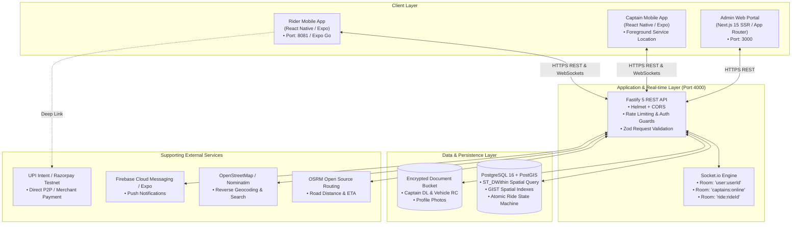
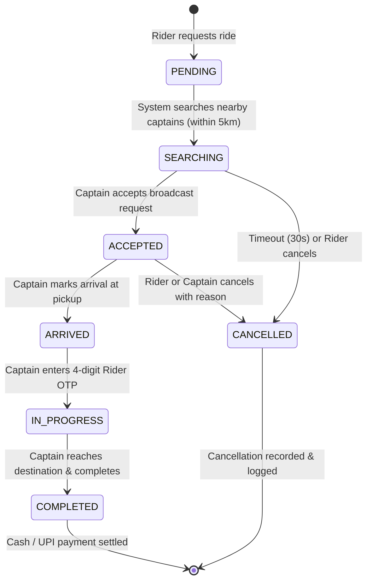

# MajuliGo System Architecture & Technical Specifications

This document defines the high-level system topology, module boundaries, network protocols, real-time event mechanisms, and technological decisions for the MajuliGo bike-taxi platform.

---

## 1. System Topology Overview

---

## 2. Real-Time Communication & Ride State Machine

Ride booking is orchestrated through a deterministic state machine synchronized between the rider, matched captain, and admin monitor.

### WebSocket Event Protocol (`SOCKET_EVENTS`)

| Event Name | Direction | Payload | Description |
| :--- | :--- | :--- | :--- |
| `authenticate` | Client → Server | `{ userId, role }` | Registers user socket and joins role-specific rooms. |
| `captain:toggle_online` | Captain → Server | `{ isOnline: boolean }` | Toggles captain availability and joins `captains:online`. |
| `captain:location_update` | Captain → Server | `{ latitude, longitude, heading, speed }` | Broadcasts live captain coordinates. |
| `captain:state_changed` | Server → Clients | `{ captainId, latitude, longitude, ... }` | Streams captain movement to rider's active map. |
| `ride:new_request` | Server → Captain | `{ rideId, pickup, destination, fare, ... }` | 30-second audio/visual request card on captain screen. |
| `ride:accept` | Captain → Server | `{ rideId }` | Locks ride to captain atomically in PostgreSQL. |
| `ride:accepted` | Server → Rider | `{ captainId, captainName, vehicle, rating }` | Notifies rider of captain assignment. |
| `ride:captain_arrived` | Captain → Server | `{ rideId }` | Alerts rider that captain has reached pickup spot. |
| `ride:start` | Captain → Server | `{ rideId, otp: "1234" }` | Validates ride start OTP; changes state to `IN_PROGRESS`. |
| `ride:location_stream` | Captain → Server | `{ rideId, latitude, longitude }` | Records live breadcrumb in `ride_locations` table. |
| `ride:complete` | Captain → Server | `{ rideId, finalFare }` | Completes ride and calculates captain earnings. |
| `ride:cancel` | Any → Server | `{ rideId, reason, cancelledBy }` | Transitions ride to cancelled and notifies other party. |

---

## 3. Technology Evaluation & Decision Record

### Decision 1: Monorepo vs. Multi-Repo
* **Choice**: **pnpm Workspace Monorepo**
* **Rationale**: Single repository allows sharing TypeScript models, Zod validation schemas, and fare calculation logic across mobile, backend, and admin web applications without duplicating code or publishing private npm packages.

### Decision 2: Separate Rider and Captain Mobile Apps
* **Choice**: **Two Independent Mobile Applications (`apps/rider` and `apps/captain`)**
* **Rationale**: Google Play Store enforces strict background location requirements (`ACCESS_BACKGROUND_LOCATION`) and prominent in-app disclosure for driver apps. Keeping the Rider app isolated prevents Play Store policy flags and keeps the app lightweight for low-end Android phones.

### Decision 3: Open-Source Maps & Routing vs Google Maps Platform
* **Choice**: **MapLibre GL + OpenStreetMap (OSM) + OSRM Routing**
* **Rationale**: Operating within a ₹5,000 budget makes Google Maps Platform ($200 monthly free tier with high per-request pricing) risky. MapLibre and OpenStreetMap are free and open-source, with no licensing fees during development and testing.

### Decision 4: PostgreSQL + PostGIS (via Supabase Free Tier)
* **Choice**: **PostgreSQL 16 with PostGIS extension**
* **Rationale**: Geospatial queries (such as finding captains within 5 km of Kamalabari Ghat) execute in single-digit milliseconds using PostGIS `ST_DWithin` and spatial `GIST` indexes. Supabase provides free cloud hosting, auth, and secure document storage for captain KYC.
