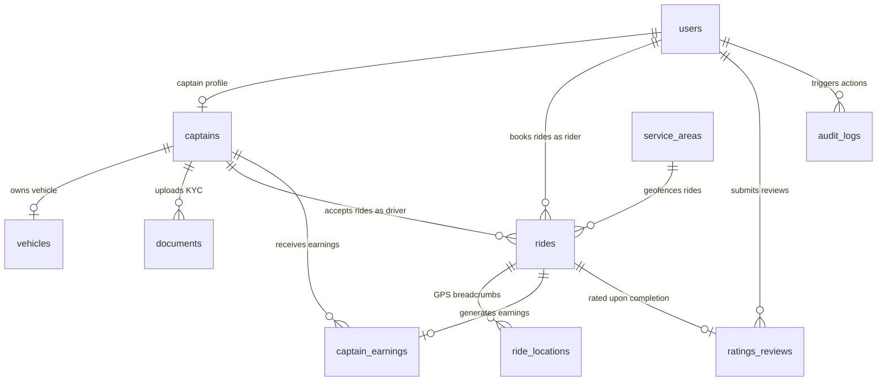

# MajuliGo Database Architecture & Spatial Modeling

This document details the relational database schema, PostGIS spatial indexing, entity relationships, and security rules for MajuliGo.

---

## 1. Entity-Relationship Diagram (ERD)



---

## 2. Table Specifications

### 1. `users`
Core user identity for riders, captains, and administrative staff.

| Column | Type | Constraints | Description |
| :--- | :--- | :--- | :--- |
| `id` | `UUID` | `PRIMARY KEY DEFAULT uuid_generate_v4()` | Unique user identifier. |
| `phone` | `VARCHAR(15)` | `UNIQUE NOT NULL` | 10-digit Indian phone number. |
| `full_name` | `VARCHAR(100)` | Nullable | Full name of rider/captain. |
| `email` | `VARCHAR(255)` | Nullable | Optional email address. |
| `role` | `VARCHAR(20)` | `NOT NULL DEFAULT 'RIDER'` | `RIDER`, `CAPTAIN`, `ADMIN`, `SUPER_ADMIN`, `SUPPORT`. |
| `avatar_url` | `TEXT` | Nullable | Profile image URL. |
| `is_active` | `BOOLEAN` | `NOT NULL DEFAULT TRUE` | Account active status. |
| `fcm_token` | `TEXT` | Nullable | Expo / Firebase push notification token. |
| `created_at` | `TIMESTAMPTZ` | `DEFAULT NOW()` | Record creation timestamp. |
| `updated_at` | `TIMESTAMPTZ` | `DEFAULT NOW()` | Record update timestamp. |

### 2. `captains`
Driver profile, verification status, and real-time geographic position.

| Column | Type | Constraints | Description |
| :--- | :--- | :--- | :--- |
| `id` | `UUID` | `PRIMARY KEY DEFAULT uuid_generate_v4()` | Captain profile identifier. |
| `user_id` | `UUID` | `UNIQUE NOT NULL REFERENCES users(id)` | User table foreign key. |
| `driving_licence_number` | `VARCHAR(50)` | `UNIQUE NOT NULL` | Indian Driving Licence (DL) number. |
| `dl_expiry_date` | `DATE` | Nullable | Expiry date of DL. |
| `verification_status` | `VARCHAR(30)` | `DEFAULT 'PENDING_VERIFICATION'` | `PENDING_VERIFICATION`, `APPROVED`, `REJECTED`, `SUSPENDED`. |
| `rejection_reason` | `TEXT` | Nullable | Reason if rejected by admin. |
| `is_online` | `BOOLEAN` | `DEFAULT FALSE` | Online availability toggle. |
| `current_location` | `GEOMETRY(Point, 4326)` | Spatial Index: `GIST` | Live GPS location (EPSG:4326). |
| `heading` | `NUMERIC(5, 2)` | Nullable | Compass bearing (0 - 360°). |
| `last_location_update` | `TIMESTAMPTZ` | Nullable | Timestamp of last received GPS coordinate. |
| `rating` | `NUMERIC(3, 2)` | `DEFAULT 5.00` | Average star rating. |
| `total_rides` | `INT` | `DEFAULT 0` | Total completed trips count. |
| `total_earnings` | `NUMERIC(10, 2)` | `DEFAULT 0.00` | Cumulative net earnings in INR. |

### 3. `service_areas`
Configurable operational boundaries with local fare rules.

| Column | Type | Constraints | Description |
| :--- | :--- | :--- | :--- |
| `id` | `UUID` | `PRIMARY KEY` | Service area identifier. |
| `name` | `VARCHAR(100)` | `NOT NULL` | Zone name (e.g., `Majuli Island District`). |
| `boundary` | `GEOMETRY(Polygon, 4326)` | Spatial Index: `GIST` | Geofence polygon boundary. |
| `base_fare` | `NUMERIC(8, 2)` | `DEFAULT 20.00` | Base fare (includes first 1.5 km). |
| `base_included_km` | `NUMERIC(5, 2)` | `DEFAULT 1.50` | Distance covered in base fare. |
| `per_km_rate` | `NUMERIC(8, 2)` | `DEFAULT 10.00` | Rate per additional kilometer. |
| `per_minute_rate` | `NUMERIC(8, 2)` | `DEFAULT 1.00` | Rate per ride duration minute. |
| `minimum_fare` | `NUMERIC(8, 2)` | `DEFAULT 25.00` | Minimum fare floor. |
| `commission_percent`| `NUMERIC(5, 2)` | `DEFAULT 15.00` | Platform commission percentage. |
| `is_active` | `BOOLEAN` | `DEFAULT TRUE` | Zone enabled/disabled toggle. |

### 4. `rides`
The central ride lifecycle transaction table.

| Column | Type | Constraints | Description |
| :--- | :--- | :--- | :--- |
| `id` | `UUID` | `PRIMARY KEY` | Unique booking identifier. |
| `rider_id` | `UUID` | `REFERENCES users(id)` | Booking rider identifier. |
| `captain_id` | `UUID` | `REFERENCES captains(id)` | Assigned captain identifier (nullable until accepted). |
| `service_area_id`| `UUID` | `REFERENCES service_areas(id)`| Geofenced service area. |
| `status` | `VARCHAR(20)` | `NOT NULL` | `PENDING`, `SEARCHING`, `ACCEPTED`, `ARRIVED`, `IN_PROGRESS`, `COMPLETED`, `CANCELLED`. |
| `pickup_address` | `TEXT` | `NOT NULL` | Human-readable pickup location. |
| `pickup_location`| `GEOMETRY(Point, 4326)` | Spatial Index: `GIST` | Pickup coordinates. |
| `destination_address`| `TEXT` | `NOT NULL` | Destination address. |
| `destination_location`| `GEOMETRY(Point, 4326)` | Spatial Index: `GIST` | Destination coordinates. |
| `estimated_distance_km`| `NUMERIC(6, 2)`| `NOT NULL` | Estimated journey distance. |
| `estimated_duration_mins`| `INT` | `NOT NULL` | Estimated duration in minutes. |
| `estimated_fare` | `NUMERIC(8, 2)` | `NOT NULL` | Quoted fare before booking. |
| `final_fare` | `NUMERIC(8, 2)` | Nullable | Final charged fare upon completion. |
| `payment_method` | `VARCHAR(20)` | `DEFAULT 'CASH'` | `CASH`, `UPI`, `CARD`, `WALLET`. |
| `payment_status` | `VARCHAR(20)` | `DEFAULT 'PENDING'` | `PENDING`, `COMPLETED`, `FAILED`, `REFUNDED`. |
| `start_otp` | `VARCHAR(6)` | `NOT NULL` | 4-digit code given to rider, entered by captain to start trip. |
| `cancellation_reason`| `TEXT` | Nullable | Recorded reason if trip cancelled. |
| `cancelled_by` | `VARCHAR(20)` | Nullable | `RIDER`, `CAPTAIN`, `ADMIN`, `SYSTEM`. |
| `started_at` | `TIMESTAMPTZ` | Nullable | Timestamp when OTP was verified. |
| `completed_at` | `TIMESTAMPTZ` | Nullable | Timestamp when captain marked completed. |

---

## 3. PostGIS Spatial Queries

### Finding Nearby Online Captains within 5 km of Pickup
```sql
SELECT 
    c.id AS captain_id,
    u.full_name,
    u.phone,
    v.registration_number,
    v.make_model,
    c.rating,
    ST_Distance(
        c.current_location::geography, 
        ST_SetSRID(ST_MakePoint($pickup_lon, $pickup_lat), 4326)::geography
    ) / 1000.0 AS distance_km
FROM captains c
JOIN users u ON c.user_id = u.id
JOIN vehicles v ON v.captain_id = c.id
WHERE c.is_online = TRUE
  AND c.verification_status = 'APPROVED'
  AND ST_DWithin(
        c.current_location::geography,
        ST_SetSRID(ST_MakePoint($pickup_lon, $pickup_lat), 4326)::geography,
        5000 -- 5,000 meters = 5 km radius
  )
ORDER BY distance_km ASC
LIMIT 10;
```
